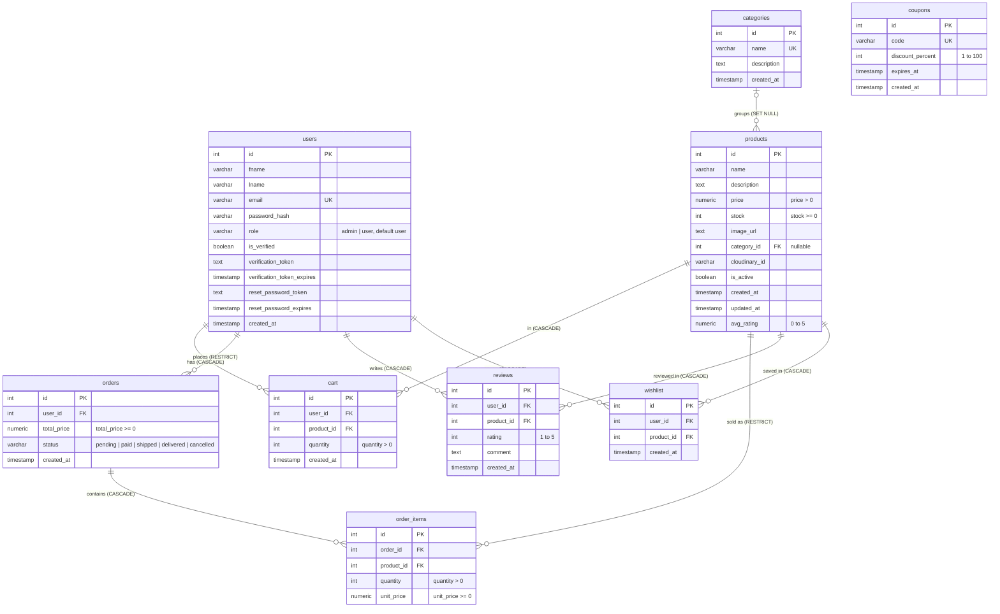

# Database ER Diagram

Entity-relationship diagram of the PostgreSQL schema defined in
[`schema.sql`](../schema.sql) (identical in structure to
[`neon_schema.sql`](../neon_schema.sql) and verified against the Neon database).
Only tables, columns and foreign keys that exist in the schema are shown.

## Notes

- **Composite unique constraints** (not expressible in Mermaid): `cart(user_id, product_id)`,
  `reviews(user_id, product_id)` and `wishlist(user_id, product_id)`, so a user has at most one
  row per product in each of these tables.
- **Foreign key delete rules**: deleting a user or product cascades to their cart, review and
  wishlist rows. Deleting a user who has orders, or a product that appears in `order_items`, is
  rejected (`RESTRICT`). Deleting a category sets `products.category_id` to `NULL`.
  Deleting an order cascades to its `order_items`.
- **`coupons` is standalone**: it has no foreign keys. A coupon is looked up by `code` at
  checkout and only its discount is applied; the order does not store which coupon was used.
- **`products.avg_rating`** is not maintained by a database trigger. The API recalculates it
  when a review is added, updated or deleted. A manual script for recalculating stale existing
  values is provided in [`sql/manual/recalculate_avg_rating.sql`](../sql/manual/recalculate_avg_rating.sql).
- **Indexes** (besides primary keys and unique constraints): `products(category_id)`,
  `cart(user_id)`, `orders(user_id)`, `orders(status)`, `orders(created_at)`,
  `order_items(order_id)`, `order_items(product_id)`, `reviews(product_id)`, `wishlist(user_id)`.
- Existing databases created before the email-verification expiry feature need
  [`migrations/20261105_add_verification_token_expiry.sql`](../migrations/20261105_add_verification_token_expiry.sql)
  to add `users.verification_token_expires`.
